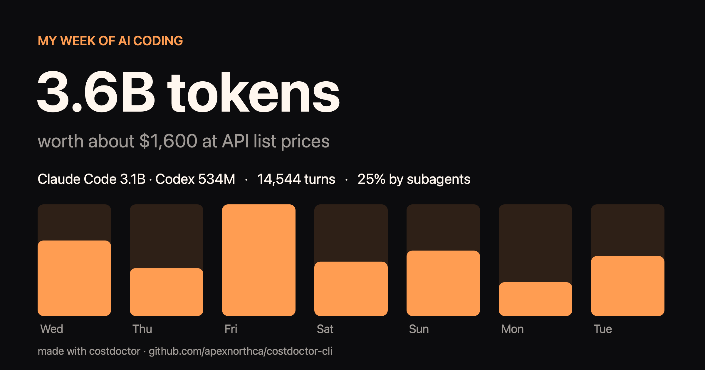

# costdoctor

[](https://github.com/apexnorthca/costdoctor-cli/releases/latest)
[](https://github.com/apexnorthca/homebrew-tap)
[](#install-without-homebrew)
[](https://github.com/apexnorthca/costdoctor-cli/releases/latest)
[](LICENSE)
[](https://github.com/apexnorthca/costdoctor-cli/stargazers)

See where your **Claude Code** and **Codex** tokens go, and when you will hit your plan limit. A free command for macOS. It reads the logs both tools already keep on your Mac, and nothing is uploaded.

```bash
brew install apexnorthca/tap/costdoctor
costdoctor
```

```
Cost Doctor · last 7 days  (read 212 log files in 3s; nothing left this Mac)

Day          Claude Code      Codex    turns  subagents   ~list price
2026-11-04          540M      72.0M     2448        25%          $269
2026-11-05          341M      47.0M     1552        19%          $171
...
Total               3.1B       534M    14544                   $1,600

Plan limits
  Claude Code 5-hour: 72% used, resets 4:10 PM
     At this pace you run out at 3:35 PM, 35 min before it resets.
     Refactor billing webhooks used about 64% of the tokens in this window.
  Codex Weekly: 41% used, resets Fri 9:00 AM
     On pace to finish this window at about 72%.

Today's heaviest sessions
    291M   1104 turns  Claude Code: Refactor billing webhooks [api-server]
          -> Compact now: it carries 374K of history on top of a 38K start, so each turn costs about 10.8x a fresh one.
          -> Subagents are 71% of its tokens today. Fewer, narrower helpers would cut it.
```

## What it tells you

- **Tokens per day** for Claude Code and Codex side by side, with turns, the share made by subagents, and an estimate at API list prices.
- **Plan limits with a forecast**: your 5-hour and weekly windows, and the time you will run out at the current pace.
- **What is eating your plan**: the heaviest sessions today, with plain advice: when to compact, a session that starts at 120K before any work because of the connectors and plugins it loads, subagents doing most of the work.

## Share your week

```bash
costdoctor card            # saves ~/Desktop/costdoctor-week.png
```



The card shows totals only: no session names, project names or prompts.

## Commands

| Command | What it does |
|---|---|
| `costdoctor` | The last 7 days, your plan limits, and today's heaviest sessions |
| `costdoctor --month` | The last 30 days |
| `costdoctor card [file]` | A picture of your week to share |
| `costdoctor --no-limits` | Skip asking Anthropic for your Claude plan limits |

## Privacy

- It reads `~/.claude/projects` and `~/.codex/sessions`. Nothing in them is uploaded.
- **Claude plan limits** come from Anthropic's usage service, asked with the Claude Code sign-in already saved on your Mac. The sign-in is only read: never changed, renewed or stored. It is sent to Anthropic and nowhere else. Turn this off with `--no-limits`.
- **Codex limits** come from your Codex logs. No network request is made for them.
- The only file it writes is `~/.costdoctor/claude-limits.json` (the percentages), plus a card when you ask for one.

## Install without Homebrew

Download the zip from [Releases](https://github.com/apexnorthca/costdoctor-cli/releases). The binary runs on Apple silicon and Intel, and it is signed and notarized by Apple. Unzip it and move `costdoctor` into a folder on your PATH. To build it from source, use `swift build -c release` (macOS 13 or later, with Xcode's command line tools).

## Want it live?

[Cost Doctor for Mac](https://costdoctor.app/?ref=github) is the menu bar app built on the same code. It puts your limit % in the menu bar and warns you before a limit runs out. It turns your screen red and pings your phone when a pull request check fails while an agent sits waiting.

## License

MIT
